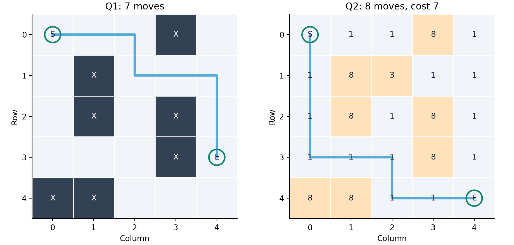
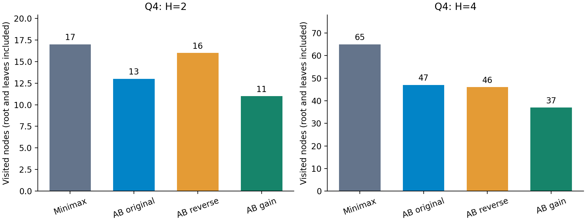

# 实验二：搜索算法实验报告

代码仓库：[https://github.com/sorrru/Project-2-A-Minimax-and-Alpha-Beta-Pruning](https://github.com/sorrru/Project-2-A-Minimax-and-Alpha-Beta-Pruning)

姓名：赵敏伊　学号：10245501442

## 1 实验目标、问题与设置

本实验实现 A\*、Minimax 与 Alpha-beta，并研究三个问题：启发函数能否减少寻路扩展；访问顺序如何改变剪枝；有限搜索深度是否影响博弈决策。假设是：合理启发函数和排序可以在保持最优结果的同时减少部分搜索，但效果依赖具体地图、平局规则和局面；加深搜索可能改变首步。

全部结果来自 `results/experiments.json`，本次生成时间为 2026-10-15 13:21:57（UTC+8）。环境为 Python 3.10.21、macOS-15.7.4-arm64-arm-64bit，核心算法只使用标准库。通过 `python run_experiments.py` 运行 23 项正确性测试后记录 26 组配置，各预热 1 次、计时 21 次；时间取中位数，全部样本和极值保存在 JSON/CSV 中。随机测试种子为 42。图表生成另用 Matplotlib，不参与算法计时。

控制变量包括地图、初始状态、评价函数和访问平局规则。A\* 邻居顺序固定为右、下、左、上，优先级相同按入队先后；博弈同值保留当前顺序最先遇到的目标。A\* 的“扩展节点”不含终点和过期堆项；博弈的“访问节点”包含根与叶子，两类指标不直接比较。有效剪枝事件只计实际跳过后续子树的次数，不是跳过节点总数。

## 2 A\* 设计与题一：迷宫寻路

**状态**为 `(row,col)`，障碍 X 不可通行；g 是起点至当前格的已知最小代价，h 是剩余代价下界，f=g+h。用 `heapq` 保存 `(f,入队序号,g,坐标)`，更小 g 出现时更新前驱并重新入队；弹出时跳过旧条目，终点弹出后沿前驱回溯，耗尽队列则无解。起点即终点返回单点路径。

题一每步代价为 1，采用曼哈顿距离 h=|r-r_E|+|c-c_E|。上下左右一次只能改变一个坐标 1，障碍只可能增加实际代价，所以 h 可采纳且一致。h=0 作为 Dijkstra 对照。课程样例路径为：

`(0,0)→(0,1)→(0,2)→(1,2)→(1,3)→(1,4)→(2,4)→(3,4)`。

路径含 8 个坐标、移动 7 步；两种启发均找到该最短路径。曼哈顿扩展 13 个节点，相比 h=0 的 15 个减少 **13.3%**（见第 3 节对照表）。这说明在该地图和固定平局规则下启发方向有用，不能推出对所有输入都有同样收益。

图 1　实测路径。蓝线为路径，深色格为障碍，橙色格为高代价地形；坐标从 0 开始。

## 3 题二：加权地形与终点零代价

边代价由“进入的目标格”决定，起点初始 g=0；S 作为普通格取 1，终点 E 取 **0**。课程样例路径为：

`(0,0)→(1,0)→(2,0)→(3,0)→(3,1)→(3,2)→(4,2)→(4,3)→(4,4)`。

进入代价依次为 **1+1+1+1+1+1+1+0=7**。因此 8 步与代价 7 并不矛盾；起点不计费，最后一步免费。

**不能直接沿用普通曼哈顿距离。** 对紧邻 E 的格，曼哈顿为 1，实际剩余代价为 0，已发生高估。设 d 为曼哈顿步数、m 为所有可通行非终点格的最低进入代价、c_E 为终点代价；非终点采用 `h=(d-1)×m+c_E`，终点 h=0。至少 d 步中的前 d-1 步必须进入非终点格，因此该式是下界。对进入终点的边满足 h=c_E，对其他相邻格 h 的下降最多为 m、不超过该边代价，故也满足一致性。本样例 m=1、c_E=0，即 `max(d-1,0)`。

修正启发下扩展节点由 14 降至 10，减少 **28.6%**，最小代价仍为 7。若普通格含 0，则 m=0，启发可能退化；这反映可保证的代价下界变弱，不能强行继续使用单位代价假设。

| 地图 | 步数／代价* | h=0 扩展数 | 启发式扩展数 | 中位耗时 ms：零／启发 |
|---|---:|---:|---:|---|
| 题一课程迷宫 | 7 | 15 | 13 | 0.0318 / 0.0405 |
| 12×12 开放网格 | 22 | 143 | 143 | 0.4615 / 0.4285 |
| 无解迷宫 SXE | -1 | 1 | 1 | 0.0039 / 0.0040 |
| 题二课程地形 | 7 | 14 | 10 | 0.0707 / 0.0810 |
| 绕远更便宜 | 3 | 4 | 4 | 0.0203 / 0.0245 |
| 零代价走廊 | 0 | 3 | 3 | 0.0143 / 0.0127 |

*前三行为步数，后三行为代价；无解的 −1 表示没有路径，题一函数实际返回 `[]`。表中的启发分别为曼哈顿／修正曼哈顿。

**自设对照解释：**12×12 开放网格起点为 (0,0)、终点为 (11,11)，两方法均扩展 143 个节点。因为每格最短 g=r+c、h=22-r-c，所以 f 恒为 22，FIFO 平局规则仍会在终点前处理其余格；启发即使精确也不保证减少这类平局中的扩展。绕远案例地图为 `[[S,9,E],[1,1,1]]`，直走代价 9，而绕下方 4 步只需代价 3，验证优化目标是代价而非步数。零代价走廊 `[[S,0,0,E]]` 的代价为 0，修正启发退化为 0，两者各扩展 3 个节点。

本次题一、题二课程样例中，启发式虽少扩展节点，中位耗时却未更低。小规模输入下启发计算和函数调用有成本，且计时受系统调度影响，不能将节点数下降直接表述为运行加速。

## 4 题三：Minimax 回传与 Alpha-beta 剪枝

根为 MAX，逐层交替：叶子返回 value；MAX 返回子值最大者，MIN 返回最小者。Alpha-beta 在递归中维护 MAX 已保证的下界 α 与 MIN 已保证的上界 β，满足 α≥β 时后续分支不能改善祖先选择，因而停止访问。负值、0 分和单叶树均作为合法输入处理。

按课程 JSON／构建代码还原，左右 MIN 均有 `[6,9]` 的 MAX 分支。其 MAX 子值分别为左侧 5、9 和右侧 9、2；MIN 回传 5、2，根返回 **5**。实现中同一 Python 节点对象被多次引用时按每次访问计数，不进行缓存。

正序剪枝发生在左侧第二个 MAX：其父 MIN 已得到 β=5，访问叶子 6 后该 MAX 的 α≥6，已不可能优于父节点原有的 5，因此叶子 9 可跳过。返回的 6 此时是足够做决策的界，不必是该 MAX 分支完整求值的精确值 9。完整搜索访问 15 个节点、8 个叶子；剪枝后为 14 个节点、7 个叶子。

| 输入 | 方法／顺序 | 最优值 | 访问节点 | 叶子求值 | 有效剪枝事件 |
|---|---|---:|---:|---:|---:|
| 课程树 | Minimax / original | 5 | 15 | 8 | 0 |
| 课程树 | Alpha-beta / original | 5 | 14 | 7 | 1 |
| 课程树 | Alpha-beta / reverse | 5 | 14 | 7 | 1 |
| 自设树 | Minimax / original | 3 | 10 | 6 | 0 |
| 自设树 | Alpha-beta / original | 3 | 8 | 4 | 2 |
| 自设树 | Alpha-beta / reverse | 3 | 10 | 6 | 0 |

课程样例正逆序开销相同，不能据此认定顺序无影响。因此另设根 MAX，下接三个 MIN 分支 `[3,5]`、`[2,9]`、`[1,8]`。正序先建立 α=3，后两支访问到 2、1 即可剪枝；逆序则更晚获得足够强的界，从 8 个节点增加到 10 个，根值仍为 3。这个对照显示：**顺序改变的是达到剪枝条件的时机，不改变正确 Minimax 值。**

## 5 题四：宝藏竞争的状态建模与深度效应

题四用同一加权 A\* 预计算 A、B、T1-T4 的距离，但特殊格进入代价均为 **1**，不得套用题二 E=0。所有 36 个矩阵项分别求解（含 6 个零距离对角项），未直接假设对称。路过宝藏不自动收集，已取宝藏仍可通行，玩家不阻挡，故寻路地图固定，博弈递归可复用距离矩阵。

| 起点\终点 | A | B | T1 | T2 | T3 | T4 |
|---|---:|---:|---:|---:|---:|---:|
| A | 0 | 12 | 10 | 4 | 8 | 8 |
| B | 12 | 0 | 8 | 8 | 4 | 10 |
| T1 | 10 | 8 | 0 | 6 | 6 | 12 |
| T2 | 4 | 8 | 6 | 0 | 6 | 6 |
| T3 | 8 | 4 | 6 | 6 | 0 | 6 |
| T4 | 8 | 10 | 12 | 6 | 6 | 0 |

宝藏值依次为 T1=9、T2=6、T3=7、T4=7。状态采用不可变结构 `(p_A,p_B,R,Score_A,Score_B,player)`；选择 Ti 后仅删除 Ti，收益为 `V_i-d(p,Ti)`，只更新行动方位置、得分，并切换玩家。负收益必须保留，规则不允许因本回合亏损而自行跳过。根由 A 行动，A 最大化 U=Score_A−Score_B，B 最小化 U；H 为行动次数，到深度上限或宝藏取完时直接返回当前 U。

| H | 方法／顺序 | A 首步 | 收益差 | 访问节点 | 叶子求值 | 有效剪枝事件 | 中位耗时 ms |
|---|---|---|---:|---:|---:|---:|---:|
| 2 | Minimax / original | T2 | -1 | 17 | 12 | 0 | 0.0693 |
| 2 | Alpha-beta / original | T2 | -1 | 13 | 8 | 2 | 0.0556 |
| 2 | Alpha-beta / reverse | T2 | -1 | 16 | 11 | 1 | 0.0567 |
| 2 | Alpha-beta / gain | T2 | -1 | 11 | 6 | 3 | 0.0476 |
| 4 | Minimax / original | T3 | 3 | 65 | 24 | 0 | 0.2232 |
| 4 | Alpha-beta / original | T3 | 3 | 47 | 16 | 5 | 0.1667 |
| 4 | Alpha-beta / reverse | T3 | 3 | 46 | 16 | 4 | 0.1638 |
| 4 | Alpha-beta / gain | T3 | 3 | 37 | 12 | 6 | 0.1447 |

图 2　H=2、H=4 的博弈节点数。AB 为 Alpha-beta，gain 为当前玩家即时收益降序；各深度内结果相同。

**为何从 T2 改选 T3？** 为排除剪枝界的影响，对每个首步独立执行完整 Minimax，得到精确分支值：

| A 首步 | H=2 最优收益差 | H=4 最优收益差 |
|---|---:|---:|
| T1 | -4 | -5 |
| T2 | -1 | 1 |
| T3 | -2 | 3 |
| T4 | -4 | -7 |

H=2 时，A 取 T2 得 6−4=2，B 取 T3 得 7−4=3，U=−1；未计入后两回合。H=4 时，一条最优对局为 A→T3、B→T1、A→T2、B→T4：

| 回合 | 玩家 | 目标 | 当次收益 | A 累计 | B 累计 | U |
|---|---|---|---:|---:|---:|---:|
| 1 | A | T3 | -1 | -1 | 0 | -1 |
| 2 | B | T1 | 1 | -1 | 1 | -2 |
| 3 | A | T2 | 0 | -1 | 1 | -2 |
| 4 | B | T4 | -5 | -1 | -4 | 3 |

A 首步取 T3 暂时亏损 1，但后续距离和目标选择限制了 B 的收益，最终 A=−1、B=−4，U=3。这里最佳收益差为正并不表示 A 的绝对收益为正。H=2 未看到该后续结果，因此选择不同；增加深度获得了更多信息，但各深度根值本来就是不同截断目标，不应声称根值随深度必然单调提高。

**排序改进：**gain 对 A、B 都按各自即时收益从高到低访问，使 A 较早提升 α、B 较早压低 β。H=4 节点从完整搜索 65 降至 37，减少 **43.1%**；相对原序 Alpha-beta 的 47 个减少 **21.3%**。这是本地图上的实测收益，不是对所有局面的保证；排序仅改变访问次序，不修改评价或贪心决定最终动作。逆序在 H=2 比正序更差（16 对 13），在 H=4 却略好（46 对 47），进一步说明“固定某种顺序总更优”不成立。

## 6 正确性、性能边界与总结

23 项测试全部通过，包括题一 100 张随机图与 BFS 对照、题二 100 张随机加权图与独立 Bellman-Ford 对照、题三 100 棵随机树的剪枝／完整搜索对照；题四全部距离与独立 Dijkstra 一致，H=1-4 的分支结果与完整行动序列穷举一致。测试还覆盖无解、起终点相同、零代价、负叶值、相等界剪枝及状态更新。这些为正确性提供支持，但不能代替对所有输入的证明。

本次核心结果与课程样例一致：迷宫 7 步、加权代价 7、博弈树得分 5、宝藏 H=2 取 T2 得 −1、H=4 取 T3 得 3。A\* 的有效性取决于代价建模与启发下界；Alpha-beta 的效率取决于访问顺序和界的建立；增深搜索会改变对后续代价的判断。

局限包括：地图和博弈规模较小；21 次重复只是同一输入的计时重复，不是 21 个独立场景，不能据此推广统计显著性；gain 仅在一张课程地图测试；未实测更大规模的内存开销或缓存收益。距离预计算与博弈时间分开记录，矩阵中位耗时为 **2.9989 ms**，不能忽略预处理成本来宣称端到端加速。未来可系统比较不同 f 平局策略、更多地图与宝藏价值、基于状态的缓存；这些均为后续方向，本文不将未做实验写成已获收益。

## 7 复现材料

`maze.py`、`weighted_terrain.py`、`game_tree.py`、`treasure_game.py` 分别对应四题；`python -m unittest -v` 执行测试，`python run_experiments.py` 更新实测记录，`python analyze_results.py` 从现有记录更新本报告和图表，`python build_report.py` 生成 HTML 与 PDF。核心代码哈希、完整地图、路径、计时样本与最优对局保存在 `results/experiments.json`，摘要与日志见 `results/summary.csv`、`results/tests.log`。图表标签使用英文，中文解释见各图图注。
